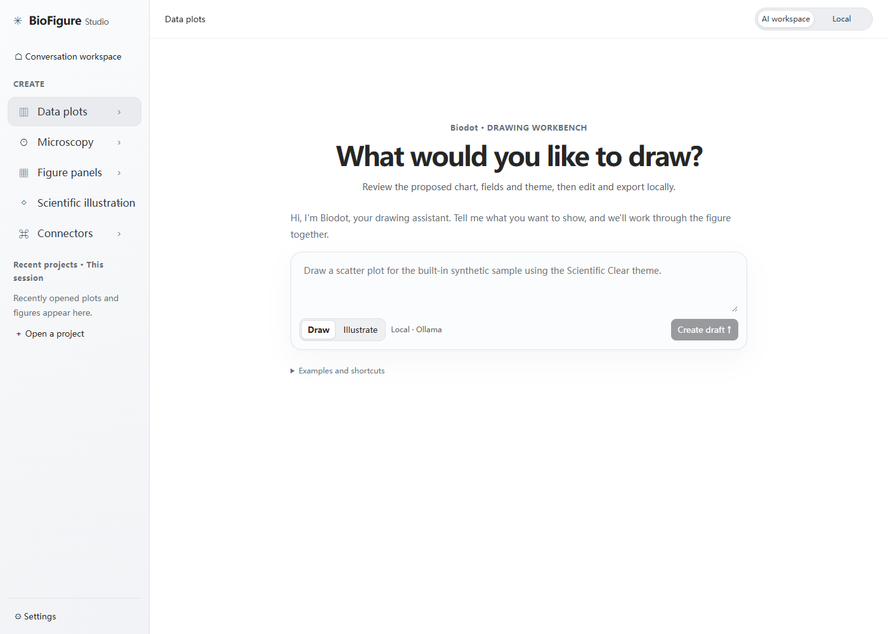
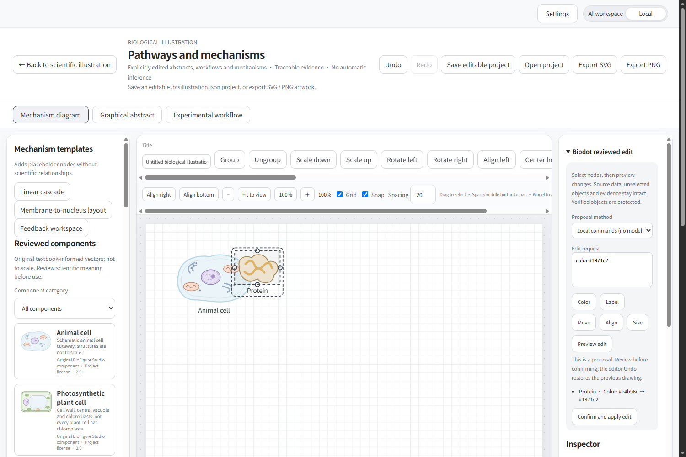
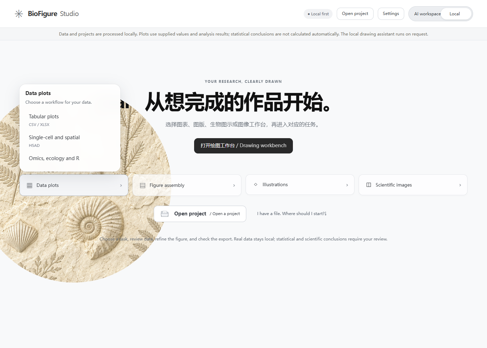
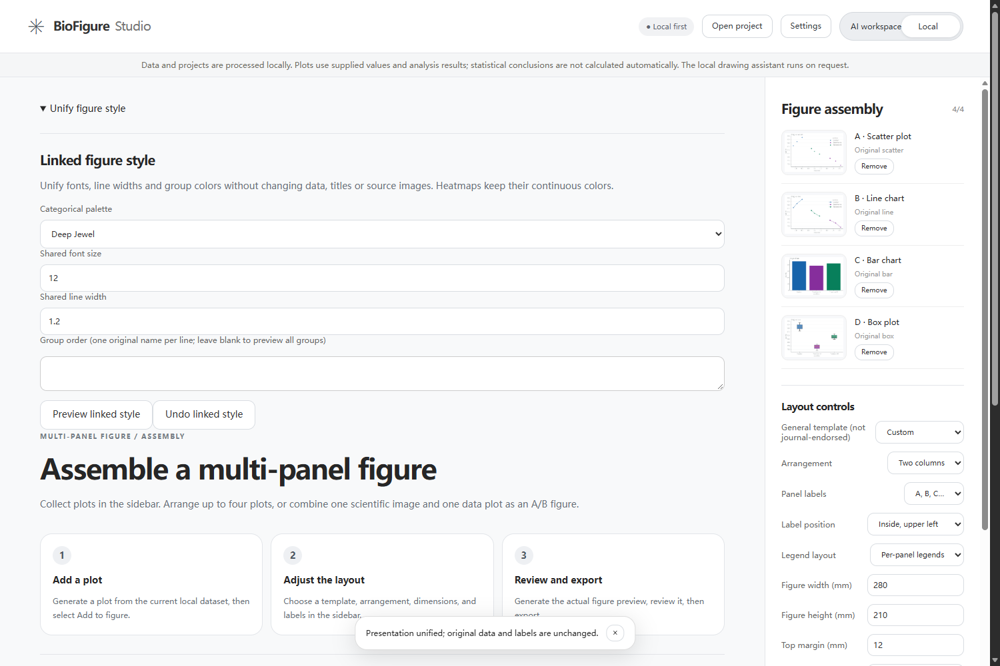
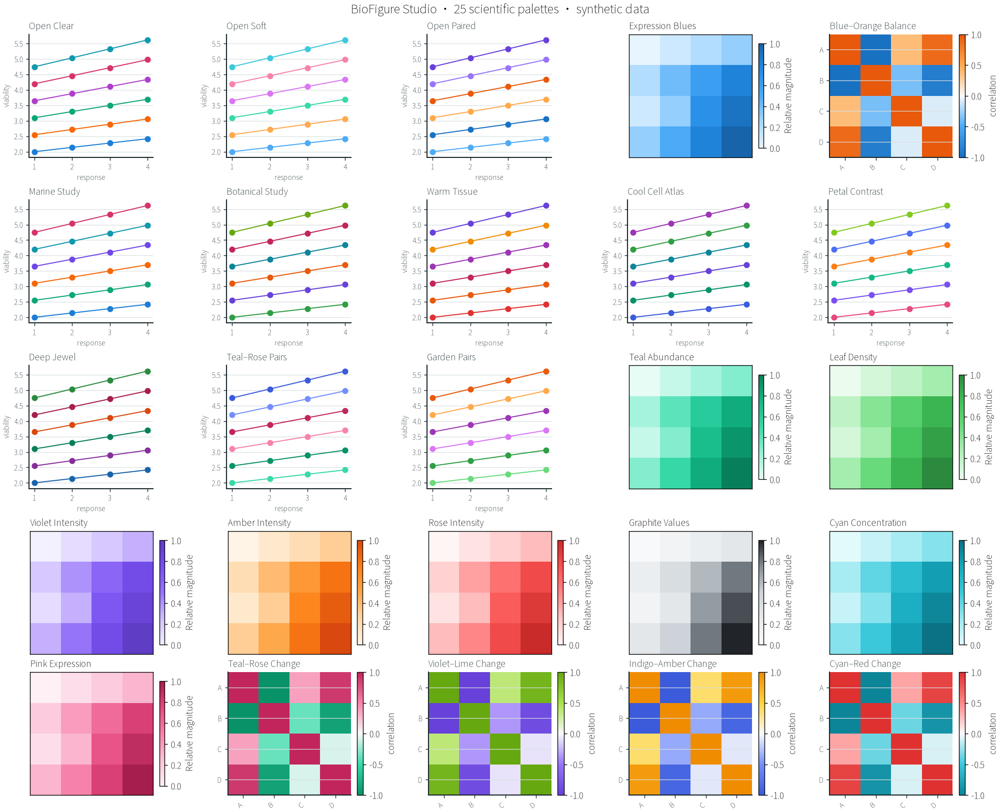
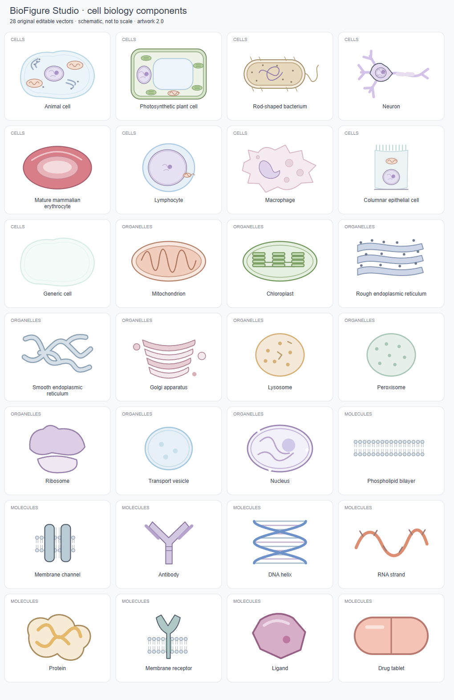
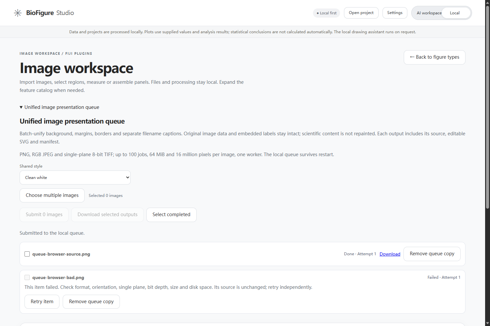
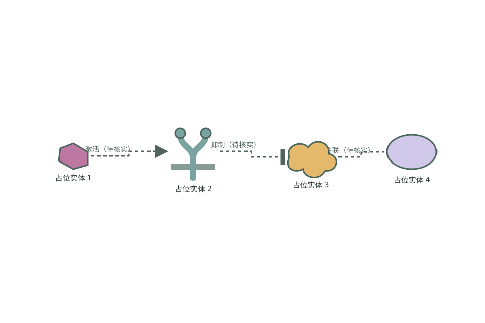
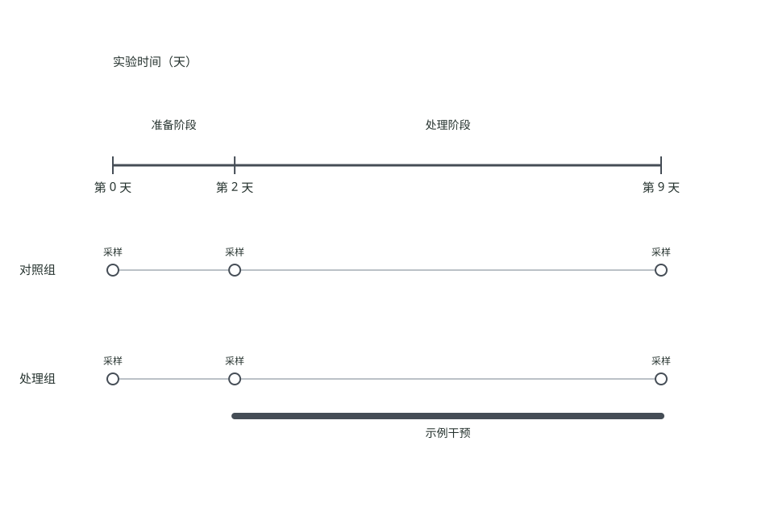

# BioFigure Studio

**English** &nbsp; 

A local-first scientific figure workbench that brings data plots, microscopy panels and editable biological illustrations into one workflow. Start with Biodot in a conversation workspace, or switch to the spotlight-style local home for direct editing. Assemble consistent manuscript figures with fewer application switches and less manual layout in slide editors.

[AI workspace](#start-with-the-ai-workspace) · [Local workspace](#work-directly-in-the-local-workspace) · [Figure workflows](#from-source-material-to-a-consistent-figure) · [Get started](#get-started) · [Roadmap](#roadmap)

> **Source update — November 13, 2026.** This README describes the current source, including the two-home navigation, 25 scientific palettes, 28 cell-biology components and the three figure-workflow additions below. These additions are not included in the previously prepared **v0.4.3 Windows installer**. A **v0.4.4 Windows x64 candidate** has been built and checked separately; see [package verification](docs/RELEASE_VALIDATION_0.4.4.md). Its attachments are prepared for a new Release, with older installers and tags preserved. See [source delivery and checks](docs/FIGURE_WORKFLOW_DELIVERY.md) and [v0.4.3 package validation](docs/RELEASE_VALIDATION_0.4.3.md).

## Two ways to begin, one figure workflow

| Start here | Best for | What happens next |
| --- | --- | --- |
| **AI workspace** — default home | Turning a supported request into a reviewable drawing proposal | Describe the task, inspect the proposal, then continue in the actual local editor. |
| **Local** — spotlight-style home | Direct plotting, image work and manual illustration without a model | Choose a task group, import local material, edit, save and export. |

The sliding **AI workspace / Local** switch is available at the top right. Opening the AI home does not automatically call a model. Switching homes retains the conversation draft and already opened image/illustration editors; save a project to keep work across restarts. Choosing a new blank illustration resets that editor explicitly.

## Start with the AI workspace

1. **Choose a task.** Use Data plots, Microscopy, Figure panels or Scientific illustration in the sidebar. Connectors have a separate entry for supported tools and configuration.
2. **Describe a supported operation.** Biodot is a warm, concise drawing assistant. The composer offers **Draw / Illustrate** and collapsible examples. Initial model-backed chart demos and workflow extraction use the documented synthetic inputs; the entry is not an unrestricted image generator.
3. **Review before execution.** Check fields, scientific content and the proposed operation. Continue in the relevant editor rather than treating a chat response as a finished figure.
4. **Refine selected illustration objects.** In the illustration editor, expand **Biodot reviewed edit**. Request color, label, movement, alignment or display size using local commands or the existing reviewed local model. Inspect affected objects and before/after values, confirm, and use Undo if needed. Verified objects remain protected; unselected objects and source data stay intact.
5. **Save and export locally.** Keep an editable project and export the formats supported by the chosen workflow.

Biodot proposes typed operations rather than executable model code. The selected-object model path is currently limited to eight nodes. Settings show the real provider/model identity. See [Biodot capabilities and DeepTutor attribution](docs/BIODOT_ASSISTANT.md).

## Work directly in the local workspace

Switch to **Local** for the original spotlight/fossil-relief home. Its artwork, pointer interaction and existing bilingual copy are preserved. Four compact task groups expose descriptions and child actions on hover; click, touch and keyboard access work as well.

| Task group | Typical workflow |
| --- | --- |
| **Data plots** | Import local CSV/Excel data, map fields, choose a chart and review its preview. Dedicated routes cover selected single-cell, spatial, genomic and ecological workflows. |
| **Figure assembly** | Collect plots or combine a scientific image and a plot, set physical dimensions, check cropping/effective resolution, and export PDF or high-resolution TIFF. |
| **Illustrations** | Build editable mechanisms, workflows, graphical abstracts and timelines. Use original cell/organellar components, then refine labels and geometry. |
| **Scientific images** | Import and measure supported images, assemble original-pixel grids, add separate annotations, or open the image presentation queue. |

Core manual plotting, assembly and illustration do not require an AI model. Fiji, R and other optional runtimes must be configured separately for their supported operations. SVG handoff to Inkscape or Illustrator supports further editing; availability of a connector does not imply complete automation of that application.

## From source material to a consistent figure

### 1. Consistent multi-panel styling

Expand **Unify figure style** in figure assembly. Choose a shared palette, font size and line width, inspect the group order/color mapping, then confirm. Up to four existing scatter, line, bar, box or heatmap panels can participate. Heatmaps retain their continuous gradients. Source values, titles, field mappings and scientific image panels stay unchanged. The operation supports stale-preview protection, atomic rendering, immediate style undo and project save/reopen.

### 2. More visual choices for biological figures

The source includes **25 scientific palettes** spanning categorical, sequential and diverging uses, with usage advice and consistent group-color mapping. **28 original vector components** cover cells, organelles and molecular structures; the editor and SVG exporter share their geometry. These are schematic components, not scale-accurate biological reconstructions. Review scientific meaning before use.

| Scientific palette catalog | Cell-biology component catalog |
| --- | --- |
|  |  |

### 3. Original pixels and batch presentation

Use original-pixel grids for supported images without resampling; keep scale bars and other annotations separate from source pixels. In the image workspace, expand **Unified image presentation queue** to submit multiple images with a shared style. Download individual results or an organized archive; retry failed items independently and resume interrupted work after restart.

The queue unifies **background, margins, borders and separate filename captions**. Each result includes an editable SVG, the original input and an integrity/operation manifest. Original data and embedded raster labels are preserved. It does not repaint microscopy or rewrite scientific labels. Supported single-plane 8-bit TIFF display conversion is recorded and checked; the original TIFF remains included.

Current queue limits: PNG, RGB/L JPEG and single-plane 8-bit TIFF; 100 retained jobs; 64 MiB/16 million pixels per image; one isolated worker; 120 seconds per item; five attempts. Stacks and higher-bit TIFF are rejected rather than flattened. See the [full limits and verification evidence](docs/FIGURE_WORKFLOW_DELIVERY.md).

## Scientific illustration gallery

These editable SVGs are actual v0.4.1 exports from synthetic examples, retained as format examples. The component catalog above shows the newer source artwork.

| Minimal vector workflow | Mechanism schematic | Quantitative timeline |
| --- | --- | --- |
|  |  |  |

Publication suitability depends on author review of scientific content, labels, accessibility, final dimensions and the target journal's requirements.

## Get started

- **Use an existing Windows package:** choose a versioned installer and its checksum from [Releases](https://github.com/Felix-Simon1202/BioFigure-Studio/releases). Read that version's notes; the current additions require v0.4.4. Candidate attachments are prepared separately; check whether that Release has been published before downloading.
- **Try the current source:** follow the [local development and Windows build guide](docs/WINDOWS_BUILD.md). Locked dependencies and optional runtime setup are documented there. No runtime/model download is triggered by opening the home screen.
- **Choose a language:** fresh profiles default to English. Open **Settings → Language** for English / 简体中文. The preference is local; switching does not translate or replace user data, scientific labels or saved project values.
- **Keep editable work:** save the relevant local project before closing. Home switching retains an editor session, not an automatically saved file.

## Data safety and model choice

Manual workflows remain local. A reviewed loopback Ollama model can provide supported AI assistance on the same computer. Selected external chart demos can use a configured API base URL, model identifier and key, with explicit per-request consent for a built-in synthetic prompt. This is not authorization to upload real research data. The packaged engine enforces loopback-only network connections; switching to the AI home does not enable an external endpoint. Use Local mode or the reviewed loopback path when data must remain on the computer.

Windows WebView2 and SmartScreen have separate platform-level network behavior. The installer is unsigned. Existing offline installation evidence covers the documented Windows 10 environment; it does not establish all Windows versions or whole-system network silence. See [security](SECURITY.md), [third-party notices](THIRD_PARTY_NOTICES.md), and [package validation](docs/RELEASE_VALIDATION_0.4.2.md).

## Roadmap

- **Reviewable AI illustration jobs:** extend beyond the delivered presentation queue to model-generated drafts with explicit scientific-content review.
- **Higher-throughput generation and processing:** extend measured capacity, supported formats and quality reports while keeping originals and labels traceable.
- **More verified software adapters:** broaden editable handoffs and controlled operations where applications expose suitable interfaces.

## License and development

Original code uses the [MIT License](LICENSE). Third-party materials retain their own terms; see the [license policy](LICENSE_POLICY.md) and [third-party notices](THIRD_PARTY_NOTICES.md). Contributions follow the [modular source and version workflow](CONTRIBUTING.md). Current source scope and validation are recorded in [the delivery log](docs/DELIVERY_LOG.md).
