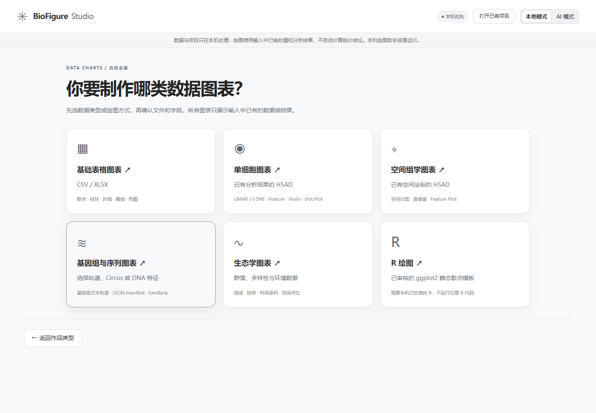
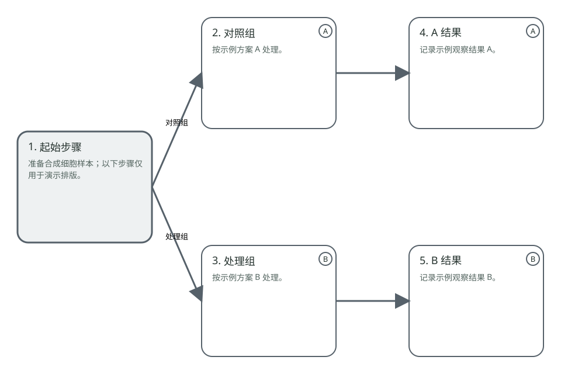

# BioFigure Studio

**English** &nbsp; 

A local-first workbench for assembling scientific figures for manuscripts. Prepare data plots, microscopy panels, and editable scientific illustrations in one workspace, then assemble and export them with consistent dimensions and typography. This reduces repeated application switching and manual layout in slide editors such as PowerPoint.

[Features](#features) · [Quick start](#quick-start) · [Illustration gallery](#scientific-illustration-gallery) · [Roadmap](#roadmap)

## Features

| Capability | What you can do in v0.4.3 |
| --- | --- |
| **Drawing tools and connectors** | Use local Fiji for supported image operations and R/ggplot2 for supported plots. Hand off editable SVG files to Inkscape or Illustrator for further editing. |
| **Original-pixel image grids** | Arrange supported images at their native pixel dimensions without resampling. Keep scale bars and other annotations separate from the source pixels, and export grids individually or in batches. |
| **Publication-oriented illustration** | Build experimental workflows, pathway diagrams, graphical abstracts, and timelines from editable components. Export SVG with editable labels for final refinement. |
| **Natural-language assistance** | Try a built-in example or describe a supported plotting task in plain language. Review the structured proposal before applying it. A compatible local model can be configured separately. |
| **Mixed figure panels and export checks** | Place plots and microscopy images in the same figure. Review panel sizing, cropping, and effective resolution before exporting PDF or high-resolution TIFF. |
| **Reopenable projects** | Save figure settings, image sources, and supported measurement state locally. Reopen projects to revise layouts or repeat exports. |
| **Research-specific plotting** | Work with CSV or Excel data for five standard chart types. Dedicated workflows also cover selected single-cell, spatial, genomic, and ecological plots. |

## Quick start

1. **Install the Windows x64 preview.** Download the setup file and SHA-256 checksum from the repository’s Releases page. Source setup is covered in the [build guide](docs/WINDOWS_BUILD.md).
2. **Choose a drawing category.** Start with the built-in synthetic dataset or import a local file. Choose a chart, image, figure layout, or illustration workflow.
3. **Prepare the figure.** Check the data or image calibration, review the preview, and adjust the layout. Use the workbench mode switch when you want model assistance.
4. **Save and export.** Save an editable local project when available. Choose SVG for vector editing or PDF, PNG, or TIFF as supported by the workflow.

### Local mode and AI mode

**Local mode** supports core plotting, image assembly, and manual illustration offline, with no model setup. **AI mode** can use a reviewed Ollama model on the same computer. The preview supports selected synthetic plotting examples, plus local extraction from a fixed synthetic methods paragraph for the dual-branch illustration workflow. The model drafts structured fields for review, and the figure is assembled from editable components.

For selected plotting demos, you can also supply an API base URL, model identifier, and API key for a compatible external provider. The preview requires explicit consent to send a built-in synthetic prompt. Use Local mode or a loopback model for a workflow that keeps processing on the same computer. The [third-party notices](THIRD_PARTY_NOTICES.md) explain Windows WebView2 and SmartScreen network behavior.

### Supported drawing categories

The category selector groups workflows by research task. Start with standard tabular plots or choose a domain-specific workflow for single-cell, spatial, genomic, or ecological data. The home screen also provides direct entries for microscopy, mixed figures, and scientific illustration.

## Scientific illustration gallery

These editable SVGs were exported from the v0.4.1 application using synthetic examples. Each uses a visual form matched to the information being communicated.

| Minimal vector workflow | Mechanism schematic | Quantitative timeline |
| --- | --- | --- |
|  |  |  |
| Branch labels distinguish the two protocols. | Connection markers distinguish activation, inhibition, and association. | Numeric time points determine the spacing between sampling events. |

Scientific content remains subject to author review. Check final dimensions, labels, and the target journal’s requirements before submission.

## Interface language

New profiles start in English. Open **Settings → Language** to choose English or 简体中文. The preference is saved locally and applies immediately. Switching preserves data, entered figure titles, and saved projects. The original spotlight artwork, pointer interaction, and bilingual text are unchanged. Future interface updates must use this shared bilingual system.

## Release and validation

The current candidate is **v0.4.3, a Windows x64 public preview**, adding English by default and a shared language preference in Settings. The installation matrix below is retained evidence for v0.4.2. That version fixes project-save failures in the packaged v0.4.1 application by including the Matplotlib and pandas distribution metadata. The gallery retains actual v0.4.1 synthetic exports; the figure interfaces and illustration features are unchanged.

Verified paths include installation, synthetic project save/reopen and PDF export, upgrade from v0.4.1, and uninstall. A fresh Windows 10 LTSC 19044 x64 guest with no WebView2, network adapter, or default route installed the bundled runtime offline and loaded the desktop homepage. This result covers that environment. A Windows 11 first install without a runtime and whole-system network behavior on a clean system have not been verified. The installer is unsigned. See the [validation scope](docs/RELEASE_VALIDATION_0.4.2.md).

## License

Original code is available under the [MIT License](LICENSE). Third-party components and fonts retain their respective licenses, and WebView2 remains subject to Microsoft terms. See the [license policy](LICENSE_POLICY.md) and [third-party notices](THIRD_PARTY_NOTICES.md).

## Roadmap

- **AI figure job queue.** Queue figure jobs, track progress, review drafts, and retry individual failures.
- **High-throughput image generation and processing.** Scale local workflows with bounded concurrency, resumable batches, and quality-control reports.
- **More drawing software integrations.** Expand verified file handoffs and add controlled automation where applications expose supported interfaces.

[Third-party notices](THIRD_PARTY_NOTICES.md) · [Security and privacy](SECURITY.md)

[Source structure and next-version workflow](CONTRIBUTING.md)
