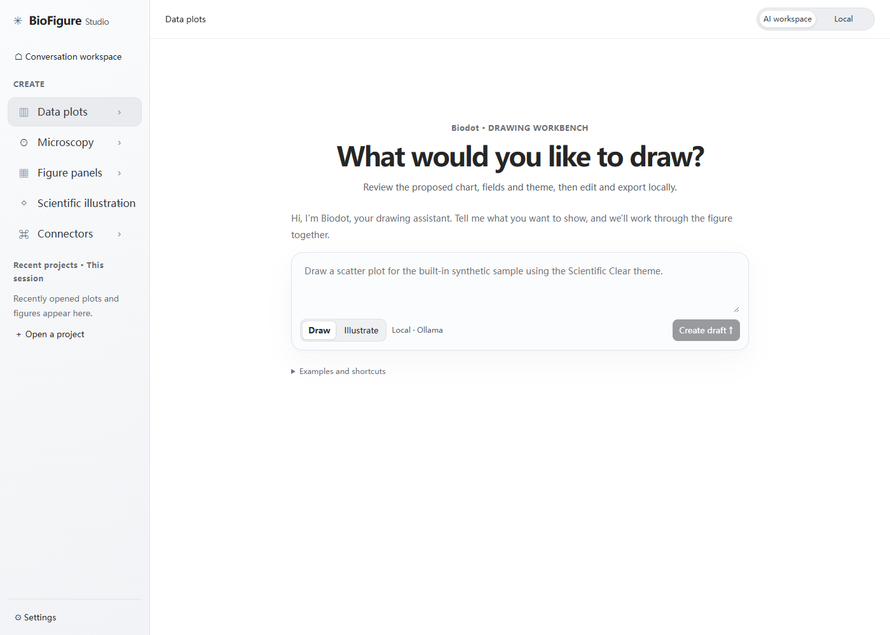
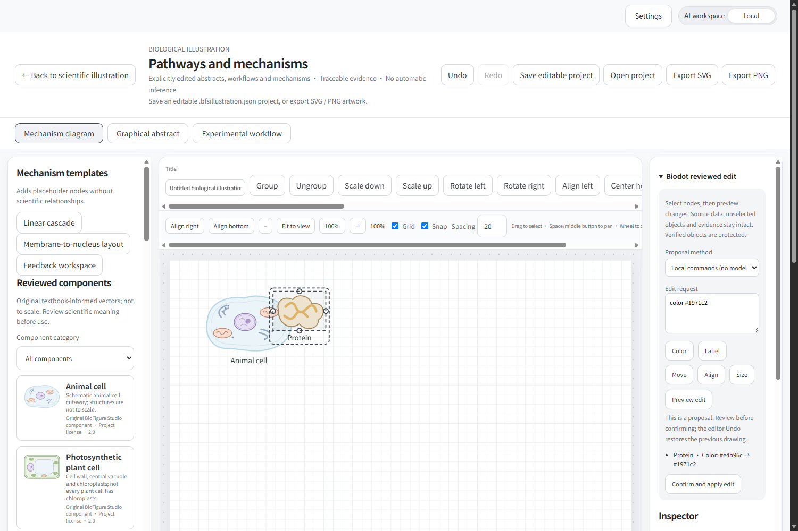
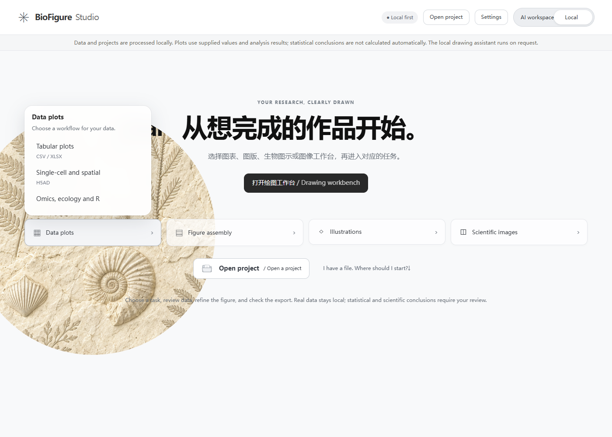
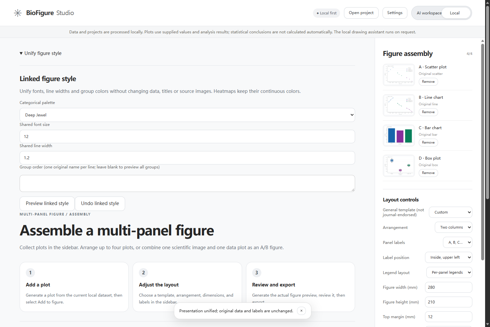
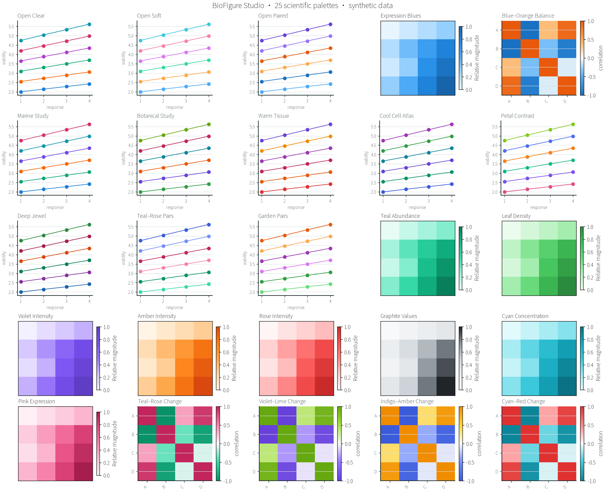
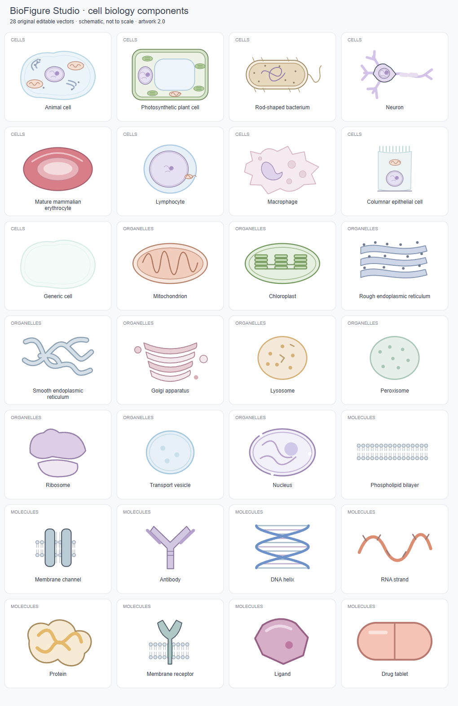
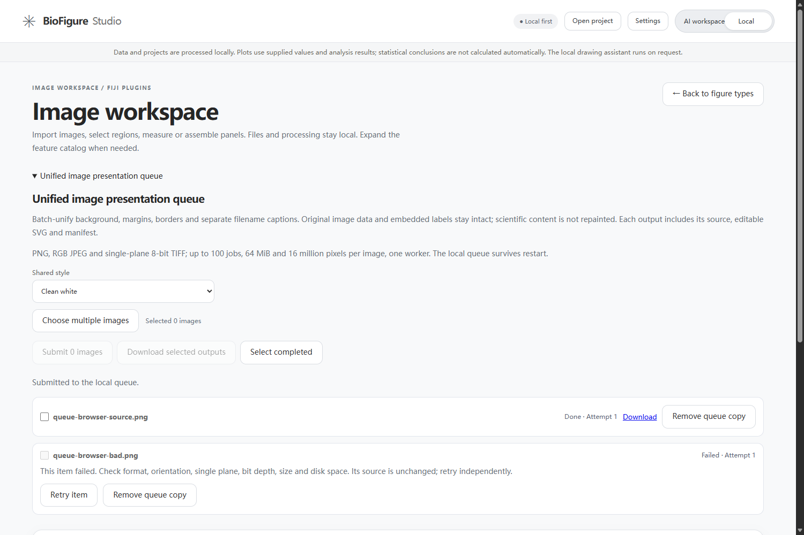
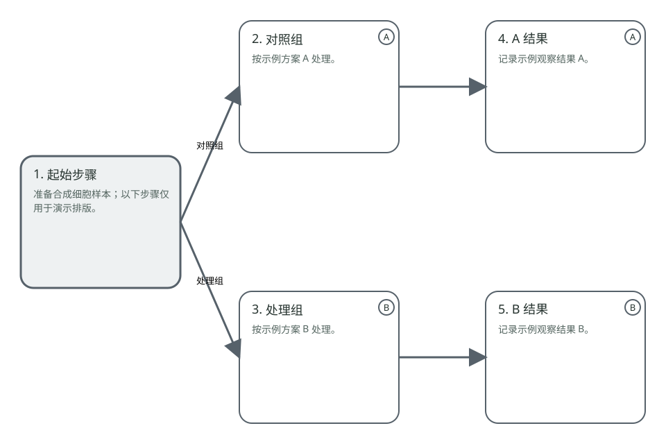
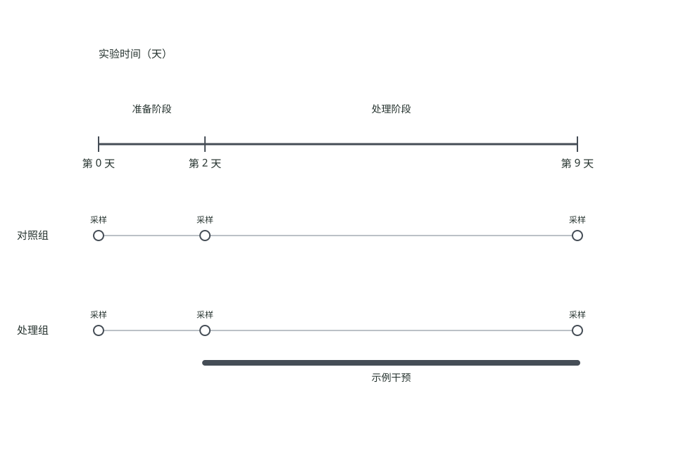

# BioFigure Studio

**简体中文** &nbsp; 

BioFigure Studio 是一个本机优先的论文图片整合工作台，将数据图表、显微图片和可编辑生物图示放入同一工作流。你可以从 Biodot 对话主页开始，也可以切换到探照灯风格的本地主页直接操作，减少软件切换和在幻灯片中手工拼版的工作，形成风格一致的论文图版。

[AI 主页](#从-ai-主页开始) · [本地主页](#在本地主页直接工作) · [图版工作流](#从原始材料到统一图版) · [开始使用](#开始使用) · [开发方向](#开发方向)

> **2026年11月13日源码更新。** 本文介绍当前源码，包括双主页导航、25 套科研配色、28 个细胞生物学组件，以及下述三项图版工作流新增能力。这些更新**不包含在此前准备的 v0.4.3 Windows 安装包中**。**v0.4.4 Windows x64 候选安装包**已另行构建并通过相关检查，见[包体验证](docs/RELEASE_VALIDATION_0.4.4.md)。附件已为新版 Release 准备，原有标签和安装包保留。详见[源码交付与验证](docs/FIGURE_WORKFLOW_DELIVERY.md)及 [v0.4.3 包体验证](docs/RELEASE_VALIDATION_0.4.3.md)。

## 两种入口，同一套图版工作流

| 从这里开始 | 适合什么情况 | 接下来怎么做 |
| --- | --- | --- |
| **AI 工作台**——默认主页 | 将受支持的自然语言需求变为可核对的绘图草案 | 描述任务，核对草案，再进入实际本地编辑器继续修改。 |
| **本地**——探照灯风格主页 | 无需模型，直接作图、处理图片和编辑图示 | 选择任务分组，导入本机材料，编辑、保存、导出。 |

右上角滑动按钮可切换 **AI 工作台 / 本地**。进入 AI 主页不会自动调用模型。切换主页保留对话草稿和已打开的图片、图示编辑器；需要跨重启保留工作时仍须保存项目。“新建空白图示”会明确重置对应编辑器。

## 从 AI 主页开始

1. **选择任务。** 侧栏按数据图表、显微图像、图版和科研图示分组。连接器独立提供受支持工具及配置入口。
2. **描述受支持的操作。** Biodot 是温暖、简洁的绘图助手。输入框提供“制图 / 生图”和可展开示例。当前模型作图演示及流程提取仍使用文档规定的合成输入；生图入口不代表已支持任意图片生成。
3. **先核对再执行。** 检查字段、科学内容与操作草案，进入对应编辑器继续工作，不把聊天回复直接视为完成的论文图片。
4. **局部修改图示对象。** 在图示编辑器展开“Biodot 局部改图”，通过本地指令或既有审核本机模型提出改色、改标签、移动、对齐和显示尺寸请求。核对受影响对象和前后差异，确认后应用，必要时撤销。已核验对象受保护，未选中对象和源数据保持原样。
5. **本地保存与导出。** 保留可编辑项目，再按工作流支持的格式导出。

Biodot 生成受约束的结构化操作，不执行模型生成代码。本机模型局部改图目前最多处理八个选中节点；设置如实显示实际模型与提供方。详见 [Biodot 能力及 DeepTutor 来源](docs/BIODOT_ASSISTANT.md)。

## 在本地主页直接工作

切换到“本地”，进入原有探照灯／化石浮雕主页。原有美工、指针交互和双语文案保持不变。四个简洁任务分组可在悬停时展开说明与子项目，同时支持点击、触屏和键盘操作。

| 任务分组 | 典型操作 |
| --- | --- |
| **数据图表** | 导入本机 CSV/Excel，映射字段，选择图表并查看预览。部分单细胞、空间、基因组和生态绘图有独立入口。 |
| **图版排版** | 收集统计图，或组合科研图片与统计图，设置物理尺寸，检查裁切和有效分辨率，导出 PDF 或高分辨率 TIFF。 |
| **科研图示** | 编辑机制图、实验流程、图形摘要和时间轴，使用原创细胞与细胞器组件，调整文字和几何布局。 |
| **科研图像** | 导入和测量受支持图片、原像素拼版、添加独立标注，或打开图片展示队列。 |

核心手动作图、拼版和图示编辑无需 AI 模型。Fiji、R 等可选运行时需为相应操作单独配置。可编辑 SVG 能交给 Inkscape 或 Illustrator 继续修改；有连接器不等于已完整自动控制该软件。

## 从原始材料到统一图版

### 1. 多面板统一样式

在图版排版中展开“统一图版样式”，选择共享配色、字号和线宽，核对分组顺序与颜色映射后确认。支持散点、折线、柱状、箱线和热图中的最多四个已有面板。热图保留连续色阶，原始数值、标题、字段映射和科研图片不变。支持过期草案保护、全部渲染成功后统一应用、本次样式撤销和项目保存重开。

### 2. 更多生物图表视觉选择

当前源码提供 **25 套科研配色**，覆盖分类、连续和发散用途，附使用建议，并可保持分组颜色一致。**28 个原创矢量组件**覆盖细胞、细胞器和分子结构，编辑器与 SVG 导出共用几何图形。这些是示意组件，不是按比例复原的生物结构，使用前仍须核对科学含义。

| 科研配色目录 | 细胞生物学组件目录 |
| --- | --- |
|  |  |

### 3. 原像素拼版与批量展示

受支持图片可按原始像素拼接，不重采样；比例尺等标注与源像素分开。在图像工作台展开“统一图片展示队列”，提交多张图片并选择共同样式，按单项或整理后的压缩包下载。失败项可独立重试，中断任务可在重启后恢复。

队列统一的是**背景、边距、边框和独立文件名说明**。每项结果包含可编辑 SVG、原始输入和核验／操作清单。保留原数据及图片内已有标签，不重绘显微图片、不改写科学标签。受支持的单平面 8 位 TIFF 会记录并核验展示转换，同时保留原始 TIFF。

当前队列支持 PNG、RGB/L JPEG 和单平面 8 位 TIFF；最多保留 100 项，每张最多 64 MiB／1600 万像素；单个隔离工作进程，每项限时 120 秒，最多五次尝试。多层和高位深 TIFF 明确拒绝，不悄悄压平。详见[完整限制与验证证据](docs/FIGURE_WORKFLOW_DELIVERY.md)。

## 科研图示示例

以下可编辑 SVG 是 v0.4.1 使用合成示例的实际导出，保留用于说明格式；上方组件目录展示较新的源码美术。

| 简约矢量流程 | 机制示意 | 定量时间轴 |
| --- | --- | --- |
|  |  |  |

是否适合投稿，仍取决于作者对科学内容、标签、可辨识度、最终尺寸和目标期刊要求的核对。

## 开始使用

- **使用已有 Windows 安装包：** 从 [Releases](https://github.com/Felix-Simon1202/BioFigure-Studio/releases) 获取对应版本与校验文件，按该版本说明使用；当前新增能力需 v0.4.4；候选附件另行交付，下载前请确认对应 Release 是否已发布。
- **体验当前源码：** 按[本地开发与 Windows 构建说明](docs/WINDOWS_BUILD.md)准备环境，依赖锁文件和可选运行时配置以文档为准。打开主页不会自动下载模型或运行时。
- **选择语言：** 新用户默认英文，打开 **Settings → Language** 可选择 English / 简体中文。偏好只存在本机，切换不翻译或替换用户数据、科学标签及已保存项目值。
- **保留可编辑工作：** 关闭前保存对应本地项目。主页切换保留编辑会话，不等于已自动保存文件。

## 数据安全与模型选择

手动工作流留在本机。已审核的回环 Ollama 模型可在同一台电脑提供受支持的 AI 辅助。部分外部作图演示可填写 API 地址、模型名和密钥，并须逐次明确同意发送内置合成指令；这不代表允许上传真实科研数据。打包引擎限制为回环网络连接，进入 AI 主页不会启用外部接口。需要数据始终留在电脑时，使用本地模式或审核后的本机回环模型。

Windows WebView2 与 SmartScreen 有独立的平台联网行为。安装包尚未签名；既有离线安装证据覆盖文档记载的 Windows 10 环境，不代表所有 Windows 版本或整机完全无网络活动。详见[安全说明](SECURITY.md)、[第三方说明](THIRD_PARTY_NOTICES.md)及[包体验证](docs/RELEASE_VALIDATION_0.4.2.md)。

## 开发方向

- **可审阅 AI 图示任务：** 在已交付的展示队列之外扩展模型草案生成，并明确核对科学内容。
- **更高通量生成与处理：** 扩大有实测依据的容量、格式与质量报告，同时保持原图、标签和来源可追溯。
- **更多经过验证的软件适配：** 在应用提供合适接口时，扩展可编辑交接与受控操作。

## 许可与开发

原创代码采用 [MIT 许可证](LICENSE)，第三方材料保留各自条款。详见[许可政策](LICENSE_POLICY.md)及[第三方说明](THIRD_PARTY_NOTICES.md)。贡献遵循[模块化源码与版本流程](CONTRIBUTING.md)，当前源码范围及验证见[交付记录](docs/DELIVERY_LOG.md)。
