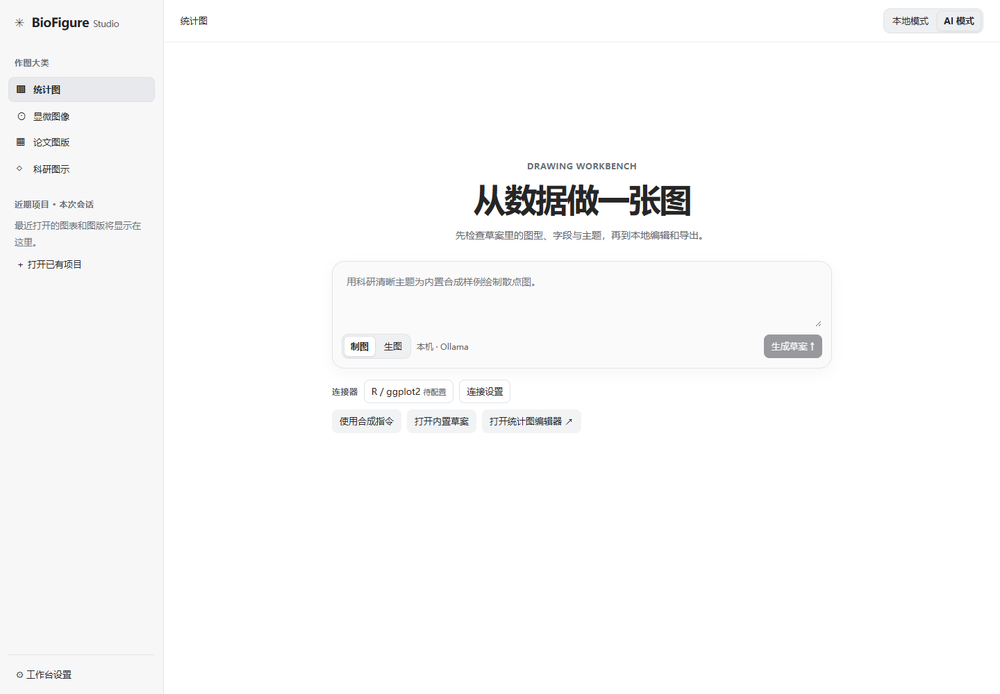
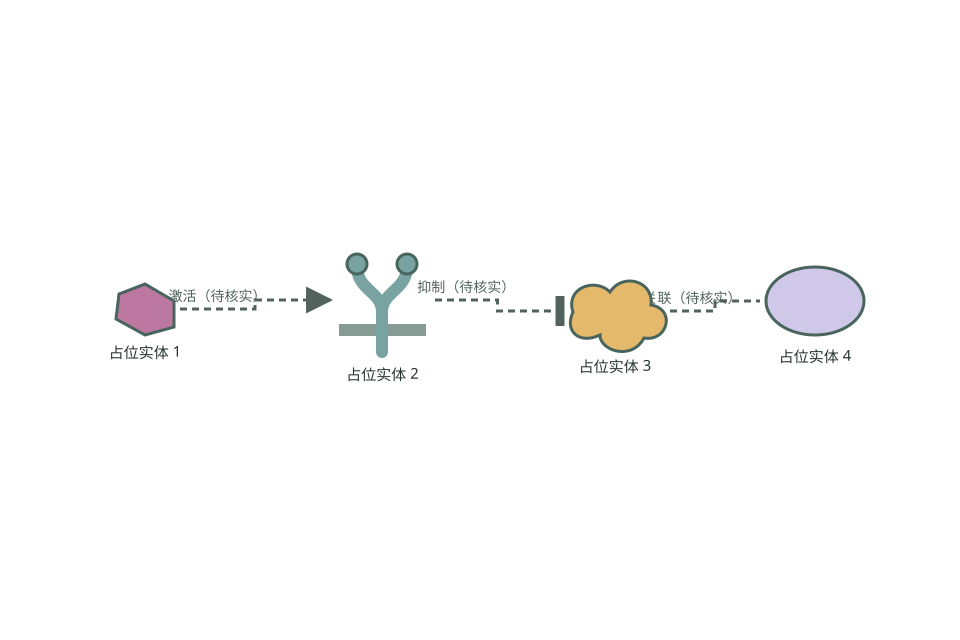

# BioFigure Studio

**简体中文** &nbsp; 

BioFigure Studio 是一个本机优先的论文图片整合工作台。统计图、显微图和可编辑科研图示可以在同一个工作台完成准备、拼版和导出，并统一尺寸与字体，减少在多个软件之间反复切换和用 PowerPoint 手动拼版的工作。

[功能特点](#功能特点) · [快速上手](#快速上手) · [科研图示示例](#科研图示示例) · [开发方向](#开发方向)

## 功能特点

| 功能 | v0.4.3 可以做什么 |
| --- | --- |
| **绘图工具与连接器** | 调用本机 Fiji 的已支持图像操作和 R/ggplot2 的已支持绘图流程。导出可编辑 SVG 后，可交给 Inkscape 或 Illustrator 继续编辑。 |
| **原像素多图拼接** | 对受支持的图像按原始像素尺寸拼接，无需重采样。比例尺等标注与源像素分开，可单次或批量导出。 |
| **面向论文投稿的科研图示** | 使用可编辑组件制作实验流程、机制图、图形摘要和时间轴，导出保留可编辑文字的 SVG。 |
| **自然语言辅助** | 使用内置示例或用自然语言描述受支持的绘图任务，核对结构化草案后再应用。可另行配置兼容的本机模型。 |
| **混合图版与导出检查** | 将统计图和显微图排在同一张图版，检查面板尺寸、裁切和有效分辨率，再导出 PDF 或高分辨率 TIFF。 |
| **可重开的本地项目** | 保存图版设置、原始图像和受支持的测量状态。重新打开项目即可修改排版或再次导出。 |
| **多种科研绘图** | 从 CSV 或 Excel 生成五类常用统计图，也提供部分单细胞、空间、基因组及生态绘图流程。 |

## 快速上手

1. **安装 Windows x64 预览版。** 在仓库的 Releases 页面获取安装包和 SHA-256 校验文件。开发环境的配置见[构建说明](docs/WINDOWS_BUILD.md)。
2. **选择绘图大类。** 用内置合成数据开始，也可导入本机文件。根据任务进入数据图表、图像、论文图版或科研图示流程。
3. **准备图版。** 检查数据或图像标定，查看预览并调整布局。需要模型辅助时，可以使用工作台上的模式切换。
4. **保存和导出。** 在支持的流程中保存可编辑项目，根据用途选择 SVG、PDF、PNG 或 TIFF。

### 本地模式与 AI 模式

**本地模式**支持离线绘图、图像拼接和手动图示，无需配置模型。**AI 模式**可接入同一台电脑上经过审核的 Ollama 模型。预览版支持部分合成样例作图，也可从固定的合成实验段落提取双分支图示所需字段。核对字段后，程序用可编辑组件排出草案。

部分作图演示也可配置兼容外部服务的 API 地址、模型名和密钥。预览版只在逐次同意后发送内置合成指令。需要将处理留在同一台电脑时，可选择本地模式或本机回环模型。Windows WebView2 与 SmartScreen 的联网行为见[第三方说明](THIRD_PARTY_NOTICES.md)。

### 支持的绘图大类

按研究任务选择入口。除了基础表格绘图，还可以进入单细胞、空间、基因组或生态绘图。首页也提供显微图像、混合图版和科研图示的独立入口。

## 科研图示示例

以下图片均由 v0.4.1 使用合成示例实际导出。可以点开查看可编辑 SVG，每种图示都选用了与信息结构相匹配的表现方式。

| 简约矢量流程 | 机制示意 | 定量时间轴 |
| --- | --- | --- |
|  |  |  |
| A/B 标识区分两条实验路线。 | 连接符号区分激活、抑制和关联。 | 按实际时间数值拉开采样间距。 |

投稿前由作者核对科学内容、尺寸、图注和目标期刊要求。

## Biodot 绘图助手

Biodot 是温暖、简洁的双语绘图助手，问候和帮助可在本机使用；设置保留实际模型身份。角色提示接入已有本机与外部模型草案流程，并按真实能力目录组织工具。先核对草案再确认执行，当前 AI 演示使用合成样例。内置示例、输入提示和固定图示标签随界面语言显示。详细范围与 DeepTutor 来源见 [Biodot 说明](docs/BIODOT_ASSISTANT.md)。

## 界面语言

新用户默认英文。打开 **Settings → Language** 可切换 English / 简体中文，选择只保存在本机，立即生效。切换不会修改数据、用户填写的图题或已保存项目。探照灯原有美工、交互和双语文字保持原样。后续界面更新必须接入同一双语系统。

## 版本与验证

当前发布候选为 **v0.4.3，Windows x64 公开测试版**，新增英文默认与设置内双语切换。以下安装矩阵为沿用的 v0.4.2 验证证据。v0.4.2 修复 0.4.1 安装版因缺少 Matplotlib/pandas 发行版元数据导致项目保存失败的问题。图示图库沿用 0.4.1 的真实合成导出，界面与图示功能保持一致。

已验证实际安装、合成项目保存重开与 PDF、0.4.1 到 0.4.2 升级和卸载。全新 Windows 10 LTSC 19044 x64 在无 WebView2、无网卡和默认路由条件下，成功离线安装运行时并加载桌面首页。该结果覆盖此环境，Windows 11 缺少运行时的首次安装和干净系统整机联网行为未验证。安装包尚未进行代码签名。详见[验证范围](docs/RELEASE_VALIDATION_0.4.2.md)。

## 许可

原创代码采用 [MIT 许可证](LICENSE)。第三方组件和字体保留各自许可；WebView2 适用微软条款。见[许可证政策](LICENSE_POLICY.md)及[第三方说明](THIRD_PARTY_NOTICES.md)。

## 开发方向

- **AI 图片工作队列。** 将任务排队，查看进度和草案，按单个任务重试。
- **工程级高通量图片生成与处理。** 支持受控并发、批次续跑和质量检查报告。
- **适配更多绘图软件。** 扩大经过验证的文件交接范围，在应用提供受支持接口时加入受控自动化。

[第三方许可说明](THIRD_PARTY_NOTICES.md) · [安全与隐私](SECURITY.md)

[源码目录与下一版开发方式](CONTRIBUTING.md)
