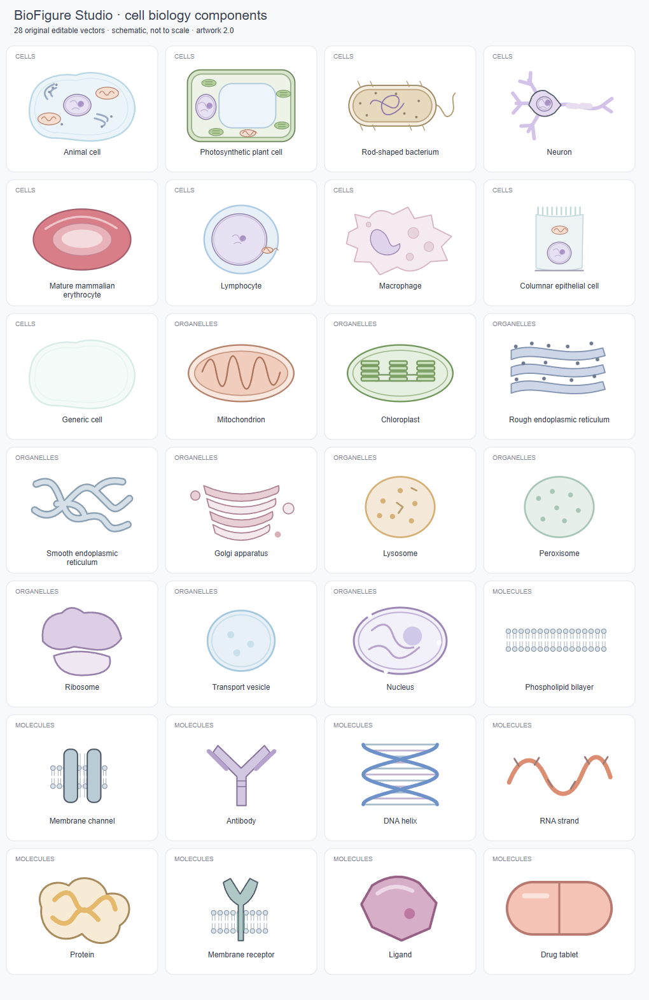

# Cell biology component artwork 2.0

## Delivery / 交付

The scientific illustration editor now has **28 original vector components**:
20 additions and a visual refresh of the previous eight. Use the library's
English/Chinese category selector for cells, organelles or membrane/molecular
components. Colors and node labels remain editable. Thumbnails, canvas, SVG
exports and rasterized PNG exports share one primitive-based vector renderer.

科研图示组件库现有 28 个原创矢量组件，新增 20 个并重绘原有 8 个。
通过分类筛选后点击放置，可改颜色、标签、大小、旋转并连接关系。
保存本地项目可继续编辑，SVG 保留矢量图形，PNG 由同一 SVG 栅格化。

[Editable vector catalog](media/cell-component-catalog.svg)

## Added components / 新增组件

| Category | Components |
| --- | --- |
| Cell types / 细胞 | Animal, photosynthetic plant, rod-shaped bacterium, neuron, mature mammalian erythrocyte, lymphocyte, macrophage, columnar epithelial cell / 动物、光合植物、杆状细菌、神经元、成熟哺乳动物红细胞、淋巴细胞、巨噬细胞、柱状上皮细胞 |
| Organelles and structures / 细胞器与结构 | Mitochondrion, chloroplast, rough ER, smooth ER, Golgi, lysosome, peroxisome, ribosome, transport vesicle / 线粒体、叶绿体、粗面与滑面内质网、高尔基体、溶酶体、过氧化物酶体、核糖体、运输囊泡 |
| Membrane/signaling / 膜与信号 | Phospholipid bilayer, membrane channel, antibody / 磷脂双分子层、膜通道、抗体 |

The refreshed legacy components are generic cell, nucleus, DNA, RNA, protein,
membrane receptor, ligand and drug tablet. Their IDs and native dimensions are
retained; older projects keep labels, positions, sizes, colors, scientific status,
relationships and evidence while using the newly requested artwork. The generic
cell remains an abstract container. Use the animal/plant entries for internal
structures. No specific ligand family, binding affinity, activity or drug dose is
inferred from a symbol. A membrane channel is typed as a protein, not universally
as a receptor. New components default to illustrative, never automatically verified.

## Textbook study / 教材参考

Reviewed on 2026-11-12. These are biological teaching references, not source
artwork assets. All paths were authored for BioFigure Studio; no textbook figure,
scan, screenshot, caption or external icon library is distributed.

- High-school AP level: [Biology for AP Courses, eukaryotic cells](https://openstax.org/books/biology-ap-courses/pages/4-3-eukaryotic-cells).
- University introductory level: [Biology 2e, eukaryotic cells](https://openstax.org/books/biology-2e/pages/4-3-eukaryotic-cells)
  and [prokaryotic cells](https://openstax.org/books/biology-2e/pages/4-2-prokaryotic-cells).
- Membranes and signaling: [membrane structure](https://openstax.org/books/biology-2e/pages/5-1-components-and-structure)
  and [ligands/receptors](https://openstax.org/books/biology-2e/pages/9-1-signaling-molecules-and-cellular-receptors).
- Cell shape examples: [neurons](https://openstax.org/books/anatomy-and-physiology-2e/pages/12-2-nervous-tissue),
  [erythrocytes](https://openstax.org/books/anatomy-and-physiology-2e/pages/18-3-erythrocytes),
  [leukocytes](https://openstax.org/books/anatomy-and-physiology-2e/pages/18-4-leukocytes-and-platelets),
  [epithelia](https://openstax.org/books/anatomy-and-physiology-2e/pages/4-2-epithelial-tissue).
- Molecular symbol: [antibody structure](https://openstax.org/books/biology-2e/pages/42-3-antibodies).

This review uses open AP-level and university texts; it does not claim a review
of a specific Chinese high-school textbook edition. Schematic cues include
nucleus/cytoplasmic separation in eukaryotes, a non-membrane-bound bacterial
nucleoid, mitochondrial inner folds, chloroplast stacks and connecting lamellae,
rough ER ribosomes versus smooth ER tubules, and inward-facing phospholipid tails.
The plant example includes mitochondria as well as chloroplasts. The erythrocyte
is explicitly a mature mammalian example without a nucleus. Library help explains
that chloroplasts/flagella and some specialized shapes are not universal traits.

中文：参考开放的高中 AP 与大学入门教材，未声称核对某一版国内高中教材。
采用原创路径表达主要结构特征，不照搬教材插图。示意图不按比例，也不是
显微形态鉴定或分子结构预测；论文中的具体结构及科学含义仍需作者核对。

## Implementation and evidence

- `illustrationArtwork.ts`: one bounded vector primitive representation, shared
  by React previews and SVG serialization; no embedded raster assets or SVG IDs
  that collide between instances. User colors must be six-digit hex values.
- `illustrationExport.ts`: separates export assembly from the interactive React
  editor and records `component_artwork_version: 2.0` in non-timeline SVG metadata.
- Existing registry/schema version and legacy IDs remain valid. Backend component
  validation now allows the 28 reviewed IDs and a provenance list of up to 28.
  Unknown IDs, executable content and scientifically verified-without-evidence
  rules remain rejected by the existing contracts.
- 13 frontend language/artwork checks passed: both interface languages, all 28
  primitives/exports, local project roundtrip, preserved user labels and invalid
  color rejection. 39 backend illustration/model-extraction checks passed.
- Actual existing headless Edge checks passed: category filtering, insertion of
  animal cell/mitochondrion/channel, project save/reopen and SVG export. Previously
  fixed canvas/side-panel wheel behavior also passed with the expanded library.
  All 28 entries can also be inserted into the default canvas: new placement is
  clamped to its bounds, without moving existing nodes. Dense diagrams may overlap
  until the user arranges nodes or expands the canvas.
- Build and lint passed; existing bundle-size/dependency warnings remain. Catalog
  SVG is reproducible with `node scripts/render_cell_catalog.cjs`; PNG was rendered
  and visually inspected with the existing local browser.
- No dependency, product network service, AI action, real data, spotlight change,
  installer rebuild, push or publication. User acceptance is pending.
