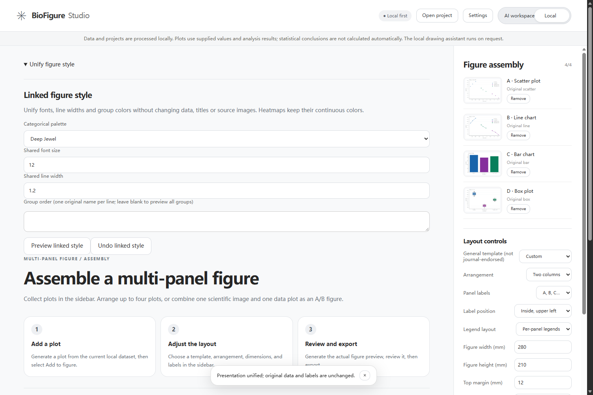
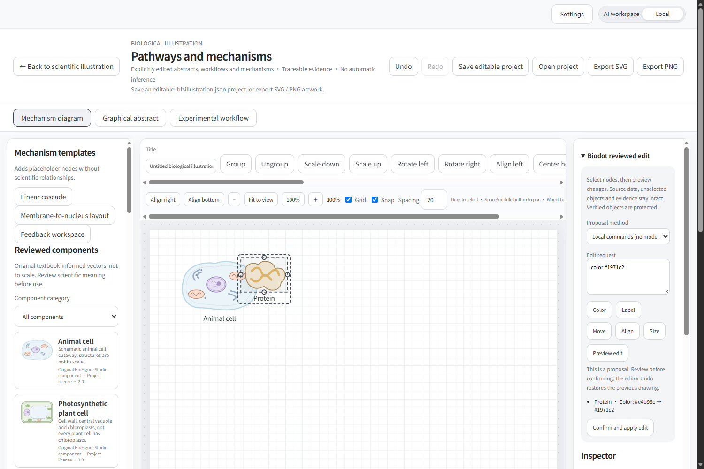
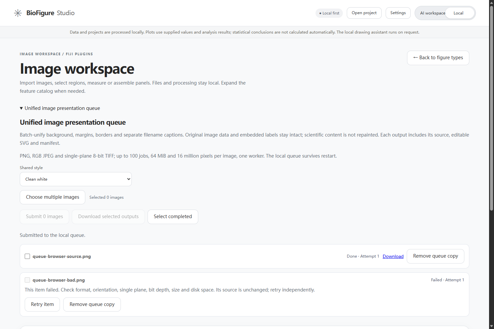

# Figure workflow source delivery / 图版工作流源码交付

2026-11-13. Ordered tasks 1 → 2 → 3 are implemented in source. User acceptance
remains pending. Existing published installers have not been replaced or rebuilt.
Subsequent user-authorized packaging produced a separate v0.4.4 candidate; see
[package verification](RELEASE_VALIDATION_0.4.4.md). The initial source-only scope
and evidence below are retained; no previous installer/tag is overwritten.
No dependencies, services, downloaded models, real research data or cloud requests
were added. The original bilingual spotlight art and pointer interaction remain
unchanged. All added interfaces use the shared English/Simplified Chinese setting.

## 1. Shared figure style / 多面板统一样式

In the figure assembly workspace, expand **Unify figure style**. Choose a categorical
palette, font size and line width. Review the discovered group names and their
explicit order/colors, preview the field changes, then confirm. Only changed chart
panels are rendered; all new snapshots must succeed before the figure is updated.
The immediate previous style can be undone; later layout/panel edits disable stale
undo. Save/reopen uses the existing project format.

This slice supports up to four existing scatter, line, bar, box or heatmap panels.
Categorical colors follow one author-confirmed group mapping. Heatmaps retain their
continuous gradient. Source values, data IDs/field mappings, scientific titles,
image panels and annotations are preserved. Changes to the figure invalidate an
old preview. This is presentation consistency, not statistical recomputation.

中文：进入图版排版，展开“统一图版样式”，选择配色、字号和线宽，核对分组顺序与
颜色映射，预览差异后确认。支持上述五类图中的最多四个面板；热图保留连续色阶。
原始数据、字段、标题和图片不变；支持本次样式撤销和项目保存重开。

## 2. Reviewed Biodot editing / Biodot 局部修改

Select explicit objects in the illustration editor and expand **Biodot reviewed
edit**. Local commands work without a model; the optional Biodot local-model mode
uses the existing reviewed loopback model only. The model returns a strict typed
intent, never executable code. Inspect affected IDs and before/after fields, then
confirm. Existing editor Undo restores the previous document.

Supported operations: color, single-object label, movement, alignment and
single-object display size. Exact command examples are shown in both languages.
The model path is bounded to eight selected nodes. Alignment/size reject unsupported
rotations; verified objects, canvas limits, evidence and document constraints remain
protected. A changed document or selection invalidates the proposal. Unselected
nodes, source data and relations remain intact. Changing a scientific label is an
explicit, reviewed operation, never an automatic language conversion.

中文：选中对象后展开 Biodot 局部修改，可使用免模型指令或既有审核本机模型。
支持颜色、标签、移动、对齐和显示尺寸五种操作；先核对差异，再应用，支持撤销。
未选中对象和源数据不动，已核验对象受保护，不执行模型生成代码，不上传科研数据。

## 3. Persistent image presentation queue / 持久化图片展示队列

In **Image workspace**, expand **Unified image presentation queue**, select a shared
style and multiple images, then submit. Three presentation styles unify background,
margins, frame and separate filename caption. Select completed items to download
one organized archive, or download individual results. Failed items retry
independently; pending/running items can be cancelled. Remove queue copies only
after keeping needed downloads. Restart resumes interrupted work rather than
rerunning completed items.

Each result contains an editable `presentation.svg`, `manifest.json` and an exact
copy of the original input. PNG and supported JPEG encoded bytes are embedded
unchanged. Supported TIFF uses a verified pixel-equivalent display PNG; its
original TIFF is retained. Full filenames are retained in SVG text/title metadata.
The manifest records source/output checks, dimensions, operations and any display
conversion. Original raster labels remain part of their untouched image content.

**Scope:** this release unifies the presentation surrounding an image. It does not
repaint microscopy, alter measured pixels, recolor internal scientific content,
OCR-rewrite labels or claim that every image becomes publication-ready.

| Limit | Current implementation |
| --- | --- |
| Formats | PNG, RGB/L JPEG, single-plane 8-bit TIFF |
| Unsupported | stacks/animations, higher-bit TIFF, CMYK, unresolved EXIF orientation |
| Capacity | 100 retained jobs, 64 MiB and 16 million pixels per input |
| Execution | one isolated worker process, 120 seconds per item, five attempts |
| Storage | 1 GiB queue budget; selected archive limited to 512 MiB |
| Recovery | persistent SQLite state, one coordinator lease, atomic outputs |
| Integrity | original SHA-256, exact source copy, recorded display conversion |

中文：批量提交，统一展示风格，逐项失败隔离、重试、取消、重启恢复和批量下载。
保留原始数据及图片内标签；每项带原图、可编辑 SVG 和核验清单。当前美化范围是
背景、边框、边距和独立文件名说明，不能把它理解为改写原图内部的科研内容。
格式及容量以表格为准；不支持的图片明确失败，不悄悄降位深或压平多层数据。

## Verification / 验证证据

- Stage 1/2 focused backend run: 23 passed. Updated four-panel PDF render and project
  roundtrip: 2 passed. Source fields, labels and group mapping checked.
- Queue run: 100 submitted items, 97 valid completed, three intentionally corrupt
  items failed independently. Retrying the three did not rerun the 97 completed
  items; source checksums matched. Restart, coordinator ownership, cancellation,
  8-bit TIFF preservation and 16-bit rejection checks passed.
- One initial filename assertion found wrapped SVG text; a complete accessible SVG
  title was added. The corrected integrity test and API archive/cleanup test passed.
- Final changed-path checks: eight selected-edit/API tests passed. Fifteen frontend
  language/UI checks, production build and lint passed. Existing bundle-size and
  framework deprecation warnings remain; no new dependency was introduced.
- Real local headless Edge checked preview/apply/undo, stale preview rejection,
  project save, selected-node edit/save/undo, upload, failure isolation, retry and
  bulk download. Downloaded source bytes and label-preservation metadata matched.
  The queue UI was rechecked after scoped checkbox/file-picker styling changes.
- The actual previously reviewed loopback model extracted a color-only intent
  from a natural-language synthetic selected-node request; unselected nodes matched.
  This is a bounded local-model check, not a claim about all external providers.
- Evidence logs and synthetic fixtures are in ignored `work/`; the three inspected
  screenshots above are tracked. No research data or machine credentials are included.

中文：已完成实际用户流程、相关自动检查及百项队列失败隔离验证；不重复已通过的
高通量测试。用户验收未代替执行。当前仅源码交付，冻结程序的多进程入口已准备，
但新安装包仍须在另行打包时验证，不把源码测试冒充安装包验证。

## Scheduled continuation / 定时续接

The one-time local continuation is scheduled for **2026-11-13 06:00 Asia/Shanghai**.
It reads this delivery and actual remaining changes first. If no authorized work
remains, it stops; it must not expand scope or repeat successful checks to consume
quota. No publication or new recurring task is authorized by this schedule.
