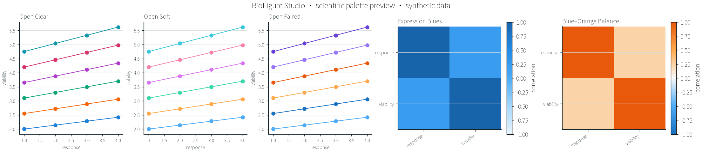

# Scientific chart color and style choices

## Scope / 范围

Improve generated biological charts rather than changing the application shell.
在生成图表的风格步骤选择配色；软件白色界面及探照灯保持原样。
All colors ship locally, English/Chinese labels follow Settings, and no network
requests, new dependencies or model downloads are needed.

## Reviewed upstream snapshots

| Project | Reviewed commit |
| --- | --- |
| [yeun/open-color](https://github.com/yeun/open-color) | `3a716ee1f5ff5456db33cb8a6e964afdca1e7bc3` |
| [weilanwl/coloruicss](https://github.com/weilanwl/coloruicss) | `ce1a7feb765f2d89b56577c5a9df96e214ed23ba` |
| [jackmoore/colorbox](https://github.com/jackmoore/colorbox) | `d6490ea29cfe6ce80908011b52d5aff58114facc` |
| [mbadolato/iTerm2-Color-Schemes](https://github.com/mbadolato/iTerm2-Color-Schemes) | `314a551246c00f9c954b581ade61855e5aaf3ab2` |
| [bgrins/TinyColor](https://github.com/bgrins/TinyColor) | `b49018c9f2dbca313d80d7a4dad25e26143cfe01` |

Open Color provides UI-oriented hue families and ten-level scales. Its MIT
licensed swatches are selected and reordered into chart palettes; this does not
establish scientific perceptual uniformity or color-vision accessibility.
ColorUI is a CSS/component library; borrow the idea of restrained saturated
accents, not its runtime/CSS. Colorbox is a jQuery lightbox and supplies no chart
palette algorithm. iTerm schemes target terminals and its license explicitly
reserves each theme author's rights, so no individual theme is included.
TinyColor documents color conversions, mixing, harmony and readability; a small
independent sRGB contrast helper is sufficient for this slice, with no library
or source code copied. Text contrast is not a test of color-vision deficiency.
All five repository licenses were read; only Open Color material is redistributed.

## User workflow / 操作流程

1. Choose or import local data, then continue to the chart style step.
2. Choose an existing palette or a new swatch card. Preview is synthetic and clearly
   labeled; generate the actual chart from current data in the next step.
3. Optionally apply a complete preset: Clean comparison, Soft composition or
   Paired comparison. It changes theme, palette, font size and line width only.
4. Check category ordering for paired colors. For supported ordered charts, exact
   category names can be entered one per line; applied when leaving the input.
5. Generate/review the actual chart, then save the project or export. Other panels
   are not recolored automatically; use the same palette and category order explicitly.

中文：确认数据 → 风格步骤选色样或一键风格 → 成对配色核对类别顺序 →
生成实际图表 → 审阅、保存和导出。切换界面语言不重写项目标题、标签或数据。

| ID | Use | Important limit |
| --- | --- | --- |
| oc_clear | Distinct experimental groups / 清晰分组 | Six hues; supplement with labels/shapes |
| oc_soft | Large soft fills / 柔和填色 | Low contrast for small marks; warning shown |
| oc_paired | Three light/dark hue pairs / 三组成对比较 | Category order determines pairing; no inferred biological roles |
| oc_blues | Low-to-high expression/abundance / 表达量蓝阶 | Sequential, not signed; correlation should prefer diverging |
| oc_balance | Negative–neutral–positive / 蓝橙双向 | Correlation preserves fixed -1 to 1 scale; not significance |

## Biodot and rendering

Biodot's capability profile includes detached bilingual palette metadata. Its
color playbook distinguishes category, magnitude and signed values. Local and
existing authorized external proposal adapters accept validated optional palette_id;
omission preserves the previous theme default. Existing task schemas and consent
remain authoritative. Native proposals still use the synthetic scatter/line slice;
this is not automatic model access to every chart type or arbitrary data.

Three categorical palettes reach table/ecology charts, categorical single-cell
and spatial displays, and genome/DNA/Circos automatic colors. Explicit per-link
Circos colors are retained. The two ramps reach continuous single-cell/spatial
plots, continuous ecology rendering through the shared helper, and table
correlation heatmaps. R connector styles are separately managed and no new cards
are offered for R. Existing colors, IDs and project formats remain unchanged.
New palette JSON is explicitly included in future frozen-engine builds.

## Validation and limits

- Actual SVG rendering, unchanged source frames/scientific labels, project config
  roundtrip, signed heatmap range, ramp endpoints, Biodot catalog/proposals and
  unknown-ID rejection are covered by focused backend tests.
- English/Chinese swatches, usage advice, categorical versus numeric selection and
  standard black/white contrast are checked with server-rendered interface tests.
- Production build, lint and spotlight preservation checks pass. Existing build
  chunk-size and dependency deprecation warnings remain unrelated.
- User acceptance and new installer packaging are pending. No claim of a newly
  tested clean Windows install, external live-model run or colorblind certification.
