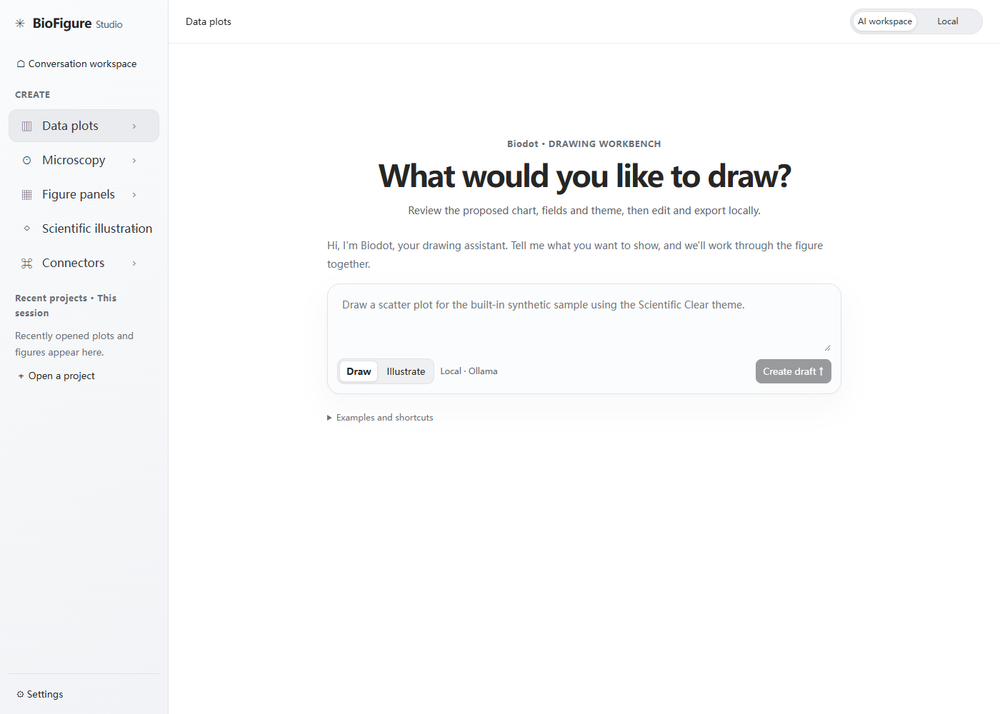
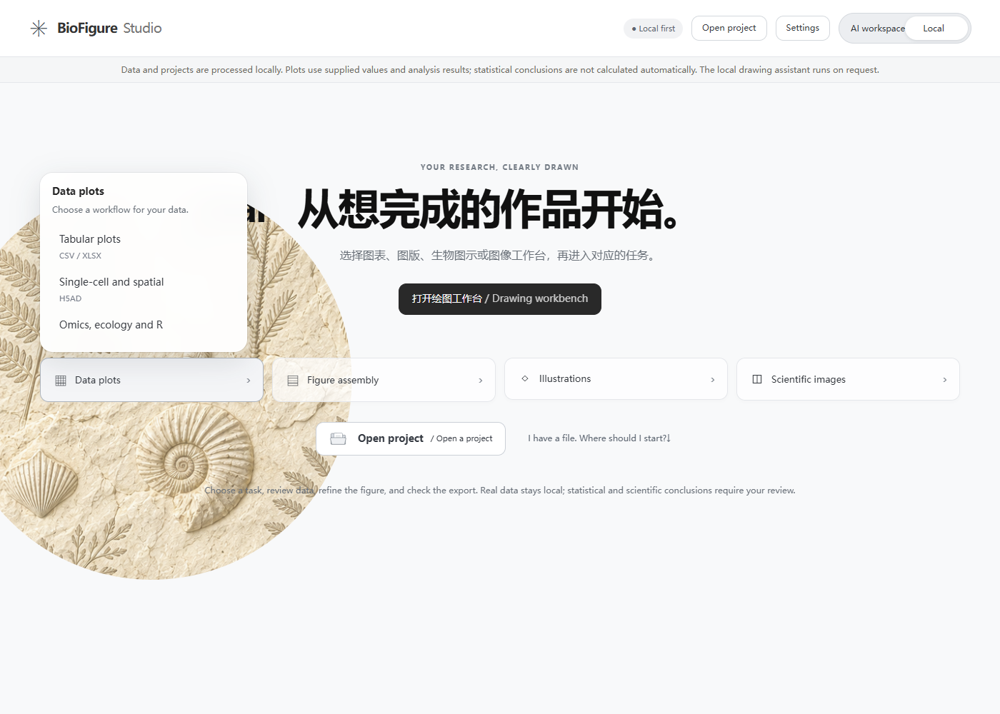

# Workspace navigation / 工作台导航

## User workflow / 使用流程

1. Start in the white Biodot conversation workspace. The Draw/Illustrate choice
   remains in the composer. Starting here does not contact a model automatically;
   existing local/external model settings and per-request consent remain in force.
2. Use the top-right sliding AI/Local switch to open the original spotlight home.
   The artwork, original bilingual heading/copy and pointer behavior are unchanged.
3. Four local task groups replace the long descriptive cards: data plots, figure
   assembly, illustrations and scientific images. Hover for help and child actions,
   or click/tap. ArrowDown enters a group's actions; Escape dismisses and returns
   focus to its trigger. Tab and outside-click dismissal also work.
4. AI sidebar groups expose workbench/local editor choices. Illustration generation
   is available from its group and from the composer. Connectors have a separate
   group with readiness and connection settings. Examples stay in a disclosure
   below the composer rather than crowding the conversation surface.
5. Recent projects and settings keep their existing sidebar locations. The AI
   draft/composer remains mounted across mode changes. Previously opened image
   and illustration editors also remain mounted when returning to the homepage;
   resume an illustration from its local group. Current plot state and figure
   panels remain in the existing parent state. Explicitly choosing a new blank
   illustration resets that editor; navigation itself does not save a project.

中文：启动进入 AI 对话工作台；右上角滑动切换到探照灯本地主页。四个创作分组
悬停显示说明与子项目，也支持点击、触屏和键盘。连接器单独分组，示例折叠。
切换模式保留对话输入和已打开的编辑器；“继续上次编辑”可返回图示。请仍按需
保存项目，保留编辑器状态不等于已自动保存文件。新建空白图示会明确重置该编辑器。

## Design and implementation

- Original local CSS uses pale neutral surfaces, fine borders, translucent panels,
  restrained shadows and short motion; no Apple or DeepTutor artwork, runtime or
  code is added. The design takes the requested interaction/layout direction.
- One NavigationGroup disclosure owns pointer, click, focus and dismissal behavior.
  Outside-pointer listeners are attached only while open. A brief pointer-leave
  delay bridges the flyout gap. Touch events do not trigger mouse-hover behavior.
- Shared WorkspaceModeSwitch uses role=switch, an accessible AI checked state,
  English/Chinese labels and a moving visual thumb. Reduced-motion settings disable
  nonessential animation. Narrow menus align inside the viewport.
- Editor retention is bounded to the existing image and illustration instances.
  Page transitions record the instances directly; there is no polling or render
  effect that updates navigation state. Hidden illustration editors disable global
  keyboard shortcuts, protecting selections from Delete in another workspace.
- The original spotlight subtree, pointer effect and artwork files remain unchanged.
  Only authorized navigation outside that subtree changes. No backend, dependency,
  AI tool permission, cloud service or scientific data transformation is added.

## Evidence / 验证

- 14 language/interface checks passed; production build and lint passed. The
  existing large-bundle warning remains unrelated to this navigation change.
- Actual existing headless Edge on an isolated local profile passed: default AI
  entry, sliding Local transition, spotlight navigation, actual illustration editor
  destination, input retention, hover flyouts, Escape/ArrowDown, illustration
  generation entry and unsaved illustration resume. Hidden editor Delete was
  checked not to alter the retained drawing.
- A 390-pixel viewport passed click-open menu bounds/no horizontal page overflow;
  native touch emulation passed tap-to-open without hover. No real model request,
  real data or external service was used by these interface checks.
- Screenshots were inspected. Local evidence: ignored work/navigation-browser.log,
  navigation-language.log and navigation-build.log. User acceptance is pending.
- Source update only: no installer replacement, push, tag or Release publication.
